<p align="center">
  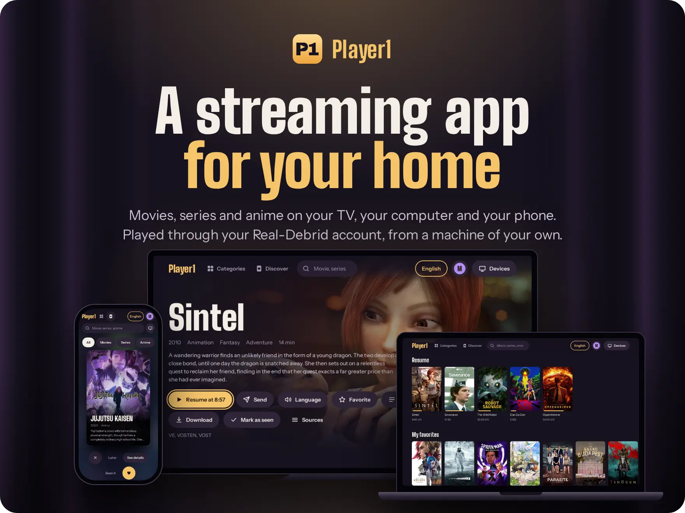
</p>

<p align="center">
  Player1 shows a catalog of movies, series and anime, and plays them through your Real-Debrid account<br>
  on your phone, your computer and your TV. You run it on a machine of your own;<br>
  nothing is converted or stored there unless you ask for a download.
</p>

<p align="center">
  <a href="#install"><b>Install</b></a> ·
  <a href="#a-look-around">A look around</a> ·
  <a href="#how-it-works">How it works</a> ·
  <a href="#first-start">First start</a> ·
  <a href="#on-the-tv">On the TV</a> ·
  <a href="#updates">Updates</a> ·
  <a href="#using-it-legally">Using it legally</a>
</p>

```sh
curl -fsSL https://raw.githubusercontent.com/boitech-dev/Player1/master/install.sh | sh
```

<p align="center"><sub>One command on a Linux machine that stays on. A few questions, arrow keys and Enter, then a link.</sub></p>

## A look around

### Your films, where you left them

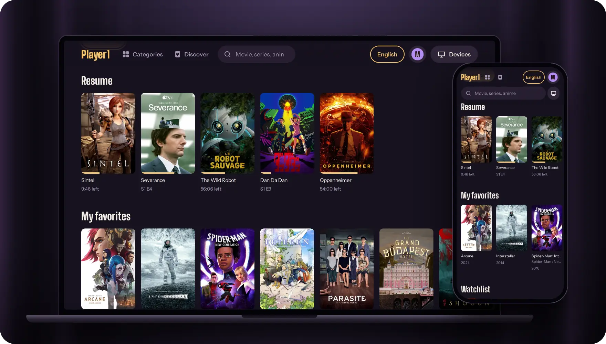

Home opens on what you were watching, then your favorites, your watchlist and any list you make, then the
catalog: trending, top rated, anime, every category. Stop a film on the TV and it is waiting on your phone, at
the same minute.

Each person at home has a profile, with their own lists, progress and languages.

### The right version, picked for you

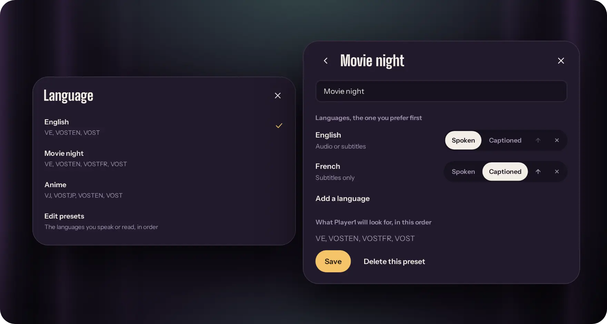

Say which languages you want to hear and which you only read, your favorite first. For every title, Player1
then picks the version, the audio track and the subtitles: a dub when you want one, the original voices with
subtitles when you don't, and never a dub by accident. When a version has no subtitles of its own, they come
from OpenSubtitles.

That is a preset. Keep several and switch from the top of the screen: one for you, one for watching with the
kids, one to practise a language. A title can also keep a choice of its own.

<sub>On screen, each choice has a short name. VE: English audio. VOSTFR: the original voices, French subtitles.
VOST: the original voices, subtitles in the film's own language.</sub>

### Pick on the phone, watch on the TV

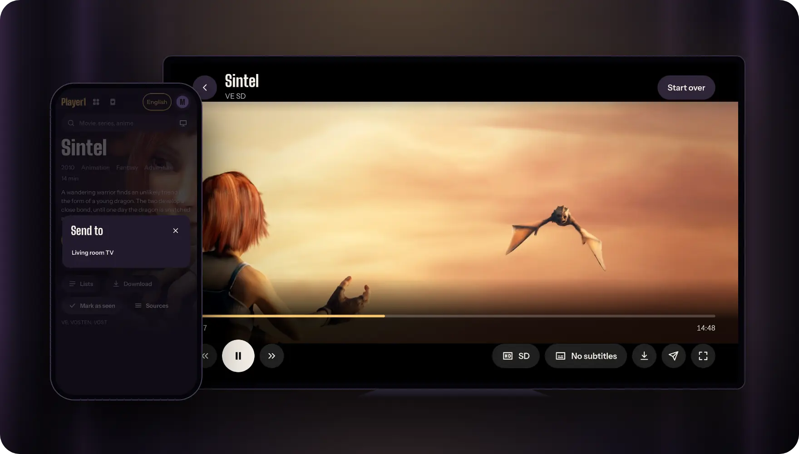

Start a film from the sofa and send it to the TV, or to any device that has Player1 open. The player has real
menus for quality, audio and subtitles, resumes where you stopped and lines up the next episode.

Each device is tested once, in a few seconds, to learn which video formats it shows smoothly. What it can play
as it is starts at once; the rest goes through Real-Debrid's converter.

<sub>The test plays eight seconds of [Sol Levante](https://opencontent.netflix.com/) (© Netflix, licensed
[CC BY 4.0](https://creativecommons.org/licenses/by/4.0/)), re-encoded in four formats. Your server fetches
them at its first start.</sub>

### A new device joins with a code

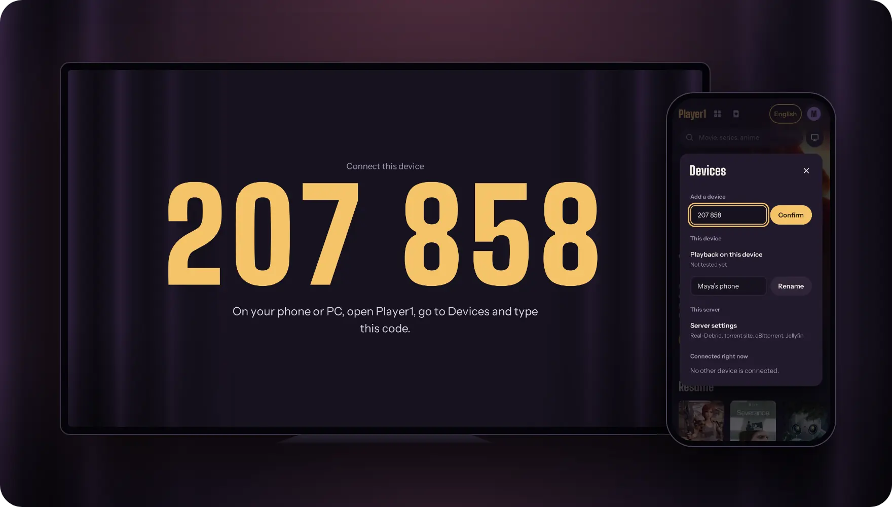

No accounts and no passwords. Open Player1's address on a new device and it shows a code. Type that code on a
device that is already in, and the new one is connected for good.

### Something for tonight

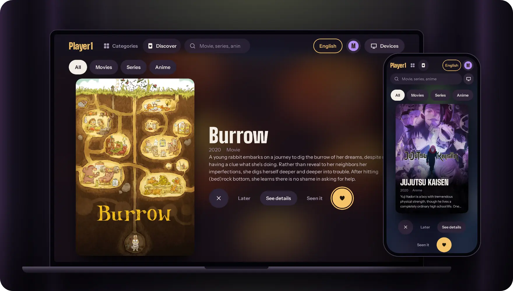

Discover suggests one title at a time. Swipe right to put it on your watchlist, left to never see it again.
Films, series or anime, as you like.

### And the rest

<table>
  <tr>
    <td width="50%">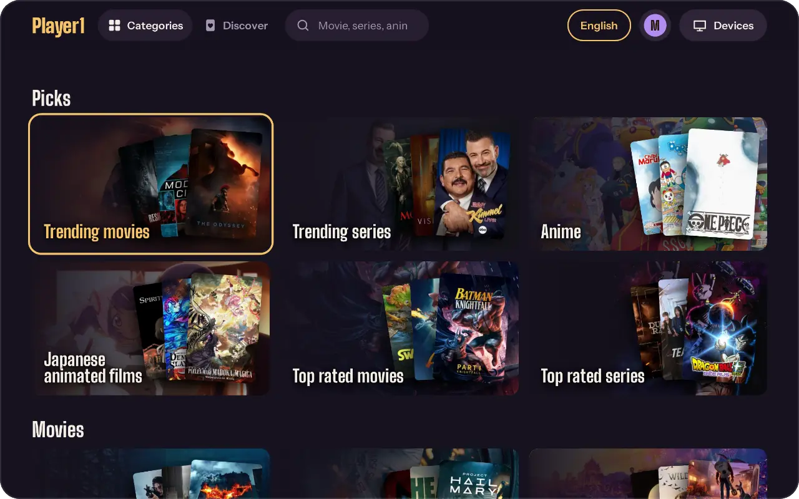</td>
    <td width="50%">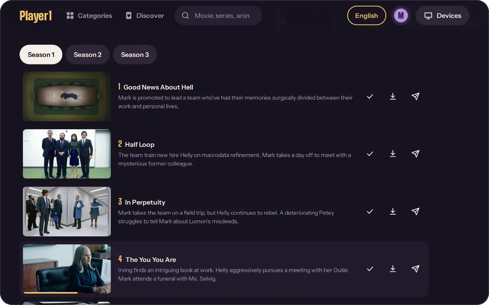</td>
  </tr>
  <tr>
    <td align="center"><sub>Every category, for movies and for series</sub></td>
    <td align="center"><sub>Seasons and episodes: mark as seen, download, send</sub></td>
  </tr>
  <tr>
    <td>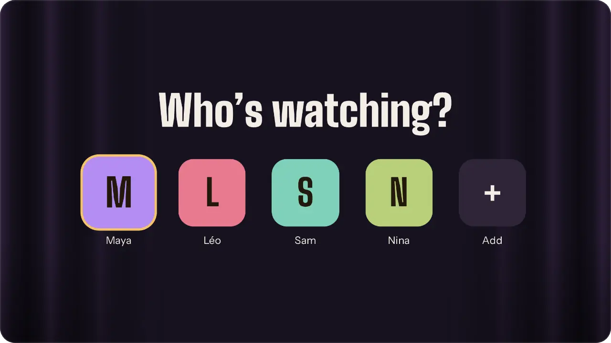</td>
    <td>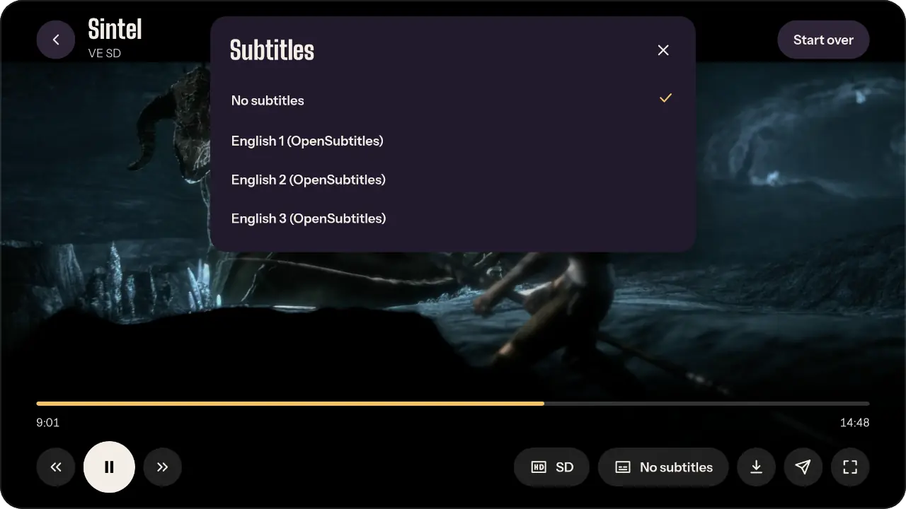</td>
  </tr>
  <tr>
    <td align="center"><sub>A profile for each person</sub></td>
    <td align="center"><sub>Subtitles from the file, or from OpenSubtitles</sub></td>
  </tr>
</table>

The interface is in English and French.

## How it works

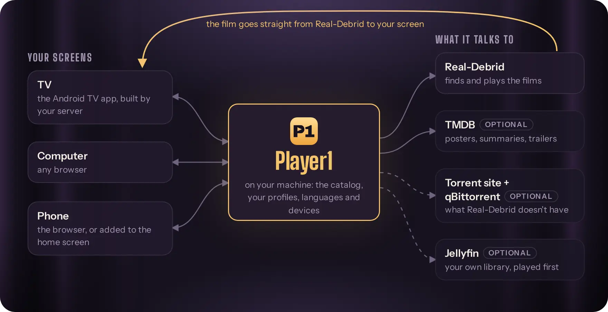

Player1 is a small server between your screens and the services you already have.

- **Real-Debrid** finds and plays the films. The film goes straight from Real-Debrid to the screen that plays
  it, so a modest machine is enough.
- **TMDB**, with a free key, adds posters, summaries, categories and trailers. Without it, the catalog only
  shows popular titles.
- **A torrent site and qBittorrent** cover what Real-Debrid doesn't have, French versions for example. Any
  site with a Torznab address works (Prowlarr and Jackett give you one); qBittorrent can be at home or on a
  seedbox.
- **Jellyfin** is your own library. What it already has plays first, and you can download any film into it to
  keep.

Only Real-Debrid is required. The rest can be added later, from the app.

## What you need

- A Linux machine that stays on: your PC, a small box at home, or a rented server.
- A [Real-Debrid](https://real-debrid.com) premium account.
- `git` and `curl`. Docker with Compose if you have it; without it, Player1 runs directly on the machine as a
  systemd service.

## Install

```sh
curl -fsSL https://raw.githubusercontent.com/boitech-dev/Player1/master/install.sh | sh
```


The installer asks a few questions, then prints a link and leaves a `player1` command for later. Choose with
the arrow keys and Enter; where a value is suggested, Enter alone keeps it.

| Question | What to answer |
|---|---|
| Language | English or Français. |
| How should Player1 run? | Asked when Docker is installed: with it (recommended) or without. Without Docker, Player1 runs as a service of the machine. |
| Install folder | Where the code and your data go. |
| Port | The first free port from 6510 is suggested. |
| How do you want to open Player1? | See below. |
| Jellyfin library, qBittorrent's downloads | Their folders, if they are on this machine. Enter alone skips them. |

### How do you want to open Player1?

**1. At home only.** Nothing else to do. Your devices open `http://<this machine>:<port>` on your network.

**2. From anywhere, with your own domain name.** You type the domain (for example `player.example.com`) and the
installer sets up HTTPS. If a web server already answers on this machine (Apache, Nginx or Caddy), Player1 is
added to it as one more site. Otherwise Player1 brings its own.
Two things are yours to do, and the installer tells you the exact values:

- at your domain name provider, an A record that points the domain to this machine;
- at home, on your internet router, ports 80 and 443 forwarded to this machine. A rented server doesn't need this.

**3. From anywhere, without a domain name: Tailscale.** [Tailscale](https://tailscale.com) is a free private
network between your own devices. The installer installs it if needed and shows a link to sign in. Afterwards,
install the Tailscale app on each device that should open Player1, and sign in with the same account.

## First start

<p align="center">
  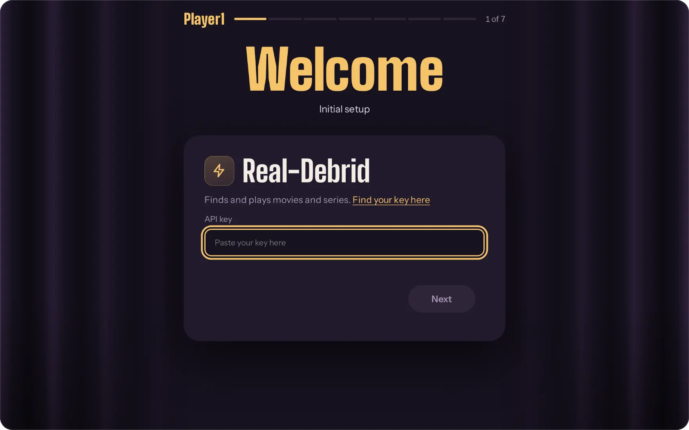
</p>

The first start builds the app, which takes a few minutes. Then open the link the installer printed:

1. **Services.** Paste your Real-Debrid key. The other services are optional and can be skipped: TMDB (posters,
   summaries and categories, with a free key), a torrent site, qBittorrent, Jellyfin. Each one is checked while
   you type.
2. **You.** Your name, your color, the languages you watch in.

To add another device, open Player1's address on it. It shows a code: type that code on a device that is already
in, under Devices. The server's settings are also under Devices, in Server settings.

## On the TV

The server builds an Android TV app for its own address. On the TV, download it from `<your address>/tv` and
install it. It updates itself afterwards. The app can only be built on an x86-64 server; elsewhere, open Player1
in the TV's browser.

### LG TV (webOS)

The server also builds an LG TV app: a launcher that opens Player1 from its own icon, already set to your
address. Server settings, under "LG TV app", install it:

- **On any LG TV:** install LG's [Developer Mode app](https://webostv.developer.lge.com/develop/getting-started/developer-mode-app)
  on the TV, turn on Dev Mode Status and Key Server in it, then type the TV's address and the passphrase it
  shows into Server settings. The server sends the app to the TV itself; no tool is needed on a computer, but
  the server must be on the TV's network. LG removes Developer Mode apps when the Developer Mode session runs
  out (extend it from the Developer Mode app).
- **With [Homebrew Channel](https://www.webosbrew.org/) on the TV:** in its settings, add the repository
  `<your address>/webos.json`, then install Player1 from the list. A new version of the app shows up there.
- **With another tool:** download `<your address>/webos` and install that `player1.ipk` with
  [webOS Dev Manager](https://github.com/webosbrew/dev-manager-desktop) or `ares-install player1.ipk`.

When its address stops answering (the server got a new one), or the package was built without one
(`node webos/build.mjs out`), the app looks for Player1 on the TV's network and lists the servers it finds;
each one says which address to reach it at. An address can still be typed by hand. The TV is paired with a
code either way.

## Updates

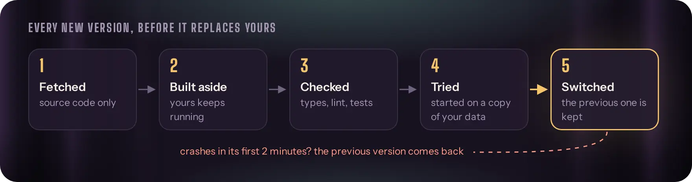

Player1 follows this repository. A new version is built and tested aside, tried, and only then replaces the
running one; if it doesn't start, the previous one comes back. Turn this off in Server settings, under Updates.

## Afterwards: the `player1` command

The installer leaves one command on the machine:

```sh
player1
```

It opens a menu for your install: see its address, change the answers you gave (port, address, folders), restart
it, read its log, or remove it. Running the installer again on a machine that already has Player1 opens the same
menu.

Removing lists what the install put on the machine (its container or service, its site in your web server with
the certificate, its Tailscale address) and asks before touching anything. You choose whether your data stays:
settings, profiles and progress are in the install folder's `data`. It leaves what isn't on the machine or isn't
Player1's: your domain's DNS record, the ports forwarded on your router, and the films downloaded into your
Jellyfin library.

<details>
<summary><b>Your own reverse proxy</b></summary>

<br>

If you'd rather write the site yourself, answer "at home only" and start from
[apache.conf.example](docs/apache.conf.example) or [nginx.conf.example](docs/nginx.conf.example). The proxy has to pass
`X-Forwarded-Proto`, and must not cut or buffer `/api/events`, which stays open. Then set the address in Server
settings.

</details>

## Using it legally

Player1 is a player. It hosts no film and comes with none: what it shows comes from the services you connect,
with your own accounts. Whether watching a title is legal depends on the title, on where it comes from, and on
the country you are in. That is yours to check. What follows is a starting point, not legal advice, and laws
change.

**Fine everywhere.** Films in the public domain or under a free licence (the screenshots above show
[Sintel](https://durian.blender.org/), a Creative Commons film), and anything its rights holder lets you
download.

**Not allowed almost anywhere.** Sharing a film without its rights holder's permission. A torrent shares what it
downloads while it downloads, so this is what the torrent site and qBittorrent do, at home or on a seedbox.

**Different from one country to the next.** Downloading or streaming for yourself, from a source that had no
right to offer the film. Going through Real-Debrid changes who fetches the file, not whether its source was
lawful; its [terms](https://real-debrid.com/terms) apply too.

| Where | The rule, in short |
|---|---|
| European Union | Streaming from an unlawful source is not covered by the exception for temporary copies ([Filmspeler, C-527/15](https://eur-lex.europa.eu/legal-content/EN/TXT/?uri=CELEX:62015CJ0527)), and a private copy must come from a lawful source ([ACI Adam, C-435/12](https://eur-lex.europa.eu/legal-content/EN/TXT/?uri=CELEX:62012CJ0435)). Each country applies this in its own law. |
| France | The private copy exception only covers copies made from a lawful source (Code de la propriété intellectuelle, art. L122-5). Arcom watches peer-to-peer sharing and [sends warnings](https://www.justice.fr/fiche/telechargement-illegal-arcom-regles). |
| Germany | A private copy is allowed unless its source is obviously unlawful ([§ 53 UrhG](https://www.gesetze-im-internet.de/urhg/__53.html)), which a film still in cinemas is. Sharing by torrent regularly ends with a lawyer's letter and a bill (*Abmahnung*). |
| Switzerland | Downloading and streaming for private use are allowed whatever the source ([CopA, art. 19](https://www.fedlex.admin.ch/eli/cc/1993/1798_1798_1798/en#art_19)). Sharing is not, which rules out torrents. |
| United Kingdom | There is no private copy exception: the one made in 2014 was [quashed in 2015](https://www.gov.uk/government/news/quashing-of-private-copying-exception). Even copying a disc you own is infringement. |
| United States | Downloading a film without permission is infringement, for private use too. A court can award $750 to $30,000 per film, and up to $150,000 when it was wilful ([17 U.S.C. § 504](https://www.law.cornell.edu/uscode/text/17/504)). |

Your Jellyfin library follows the same rules: in many countries, copying a disc you bought is only allowed when
it has no copy protection, or not at all.

## Working on the code

Node 26, npm workspaces: `packages/shared` (the API's types, the language logic), `packages/server`,
`packages/web` (React). `run.mjs` is what runs in production: it builds, starts, updates and rolls back.

```sh
npm install
npm run dev      # server and interface, reloading as you edit
npm run check    # types, lint, tests, build
```

Texts are in `packages/*/src/locales/*.po`. After changing one in the code: `npm run i18n:extract`.

## License

Player1 is free software under the [GNU Affero General Public License v3](LICENSE): use it, change it, share it.
If you run a changed version for other people over a network, offer them its source code too.
